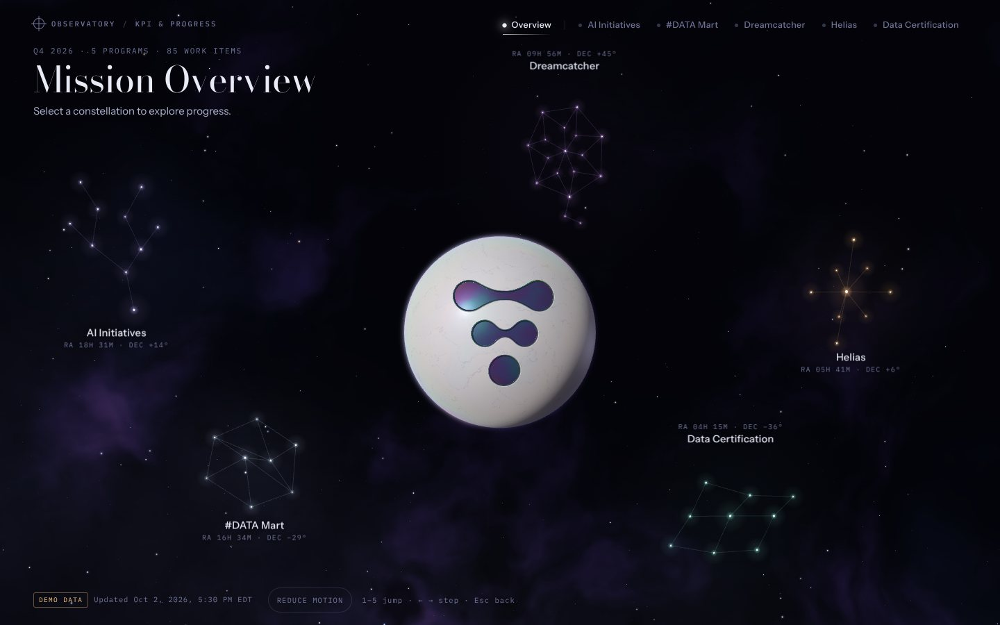
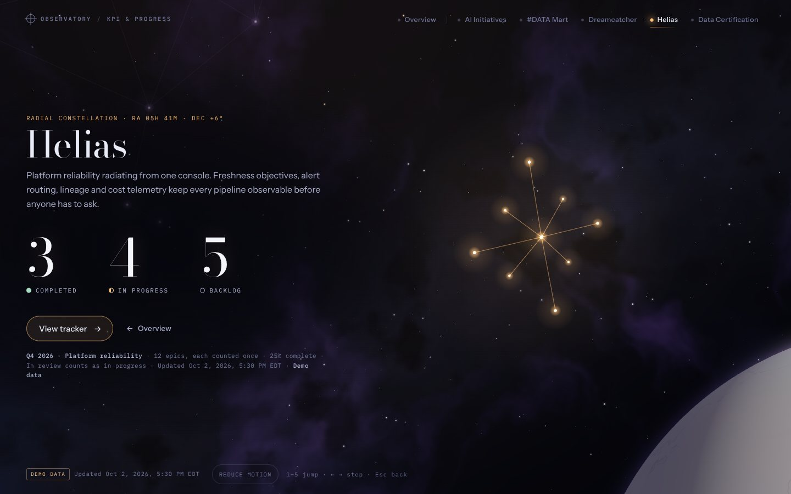
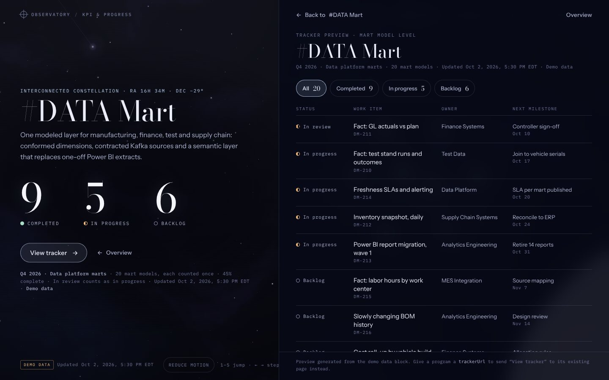
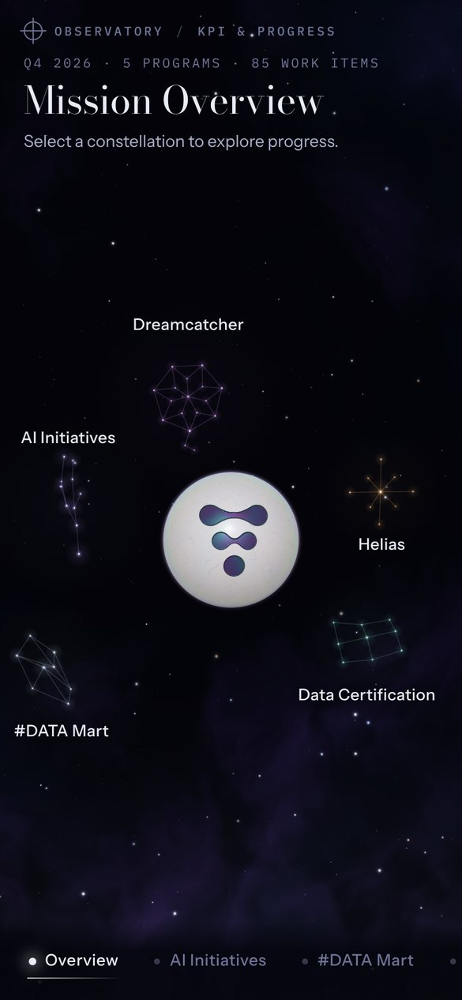

# Mission Observatory

A KPI and progress tracker designed as a celestial observatory. A pearl-and-marble planet, inlaid with the Relativity Space symbol, sits among five constellations, one for each program. Selecting a constellation flies the camera around the planet to it and reveals three numbers: Completed, In progress and Backlog. From there, **View tracker** opens the program's work items.



| Destination | Tracker preview |
| --- | --- |
|  |  |



## The journey

1. **Overview.** The planet and all five constellations, each at a fixed position so people learn where things live. Hovering over or focusing a constellation brightens its stars, traces its lines and shows a one-line description.
2. **Flight.** The camera orbits the planet and moves forward over 1.4–1.8 s, with eased start and landing. The three star layers move at different rates for parallax. A new selection mid-flight redirects smoothly from the current velocity.
3. **Arrival.** The title and summary appear first. The three numbers then settle in 150 ms apart, with a short count-up. Leaving dissolves them before the next set appears.
4. **Tracker.** **View tracker** opens the program's work items, with status filters, owners and next milestones. **Back** returns to the same destination.

| Program | Constellation | Accent |
| --- | --- | --- |
| AI Initiatives | branching | cool violet |
| #DATA Mart | interconnected | blue-white |
| Dreamcatcher | woven | purple |
| Helias | radial | amber |
| Data Certification | ordered lattice | soft teal |

## Run it

`index.html` is self-contained. Open it in a browser, or turn on GitHub Pages for the repo root. Fonts and three.js (r128) load from Google Fonts and cdnjs.

To change anything, edit `src/` or `data/` and rebuild:

```sh
python3 tools/build.py                       # demo data
python3 tools/build.py --data path/to.json   # any file with the same shape
```

The build writes two files:

- `index.html`: a full HTML document.
- `dist/observatory.html`: the same page without `<html>`/`<head>`/`<body>`, the form published as a Claude artifact.

## Layout

```
src/index.html                    markup and build placeholders
src/styles.css                    tokens, layout, overlay typography, phone layout
src/observatory.js                scene, camera flights, constellations, routing, tracker preview
data/tracker-data.demo.json       demo data (the only data source the page reads)
assets/relativity-symbol.svg      the symbol, taken from the Relativity Space logo file on relativityspace.com
assets/relativity-symbol-sdf.png  distance-field texture the planet shader engraves from
tools/build.py                    inlines everything into index.html and dist/observatory.html
tools/make_symbol_sdf.py          regenerates the texture if the symbol SVG changes
docs/                             screenshots
```

## Data

The visuals read only from the tracker data, so the real feed can replace the demo file without touching the scene.

```jsonc
{
  "meta": { "isDemo": true, "asOf": "2026-10-02T17:30:00-04:00", "label": "..." },
  "destinations": [
    {
      "id": "helias",                 // matches a constellation in IDENTITY (src/observatory.js)
      "name": "Helias",
      "tagline": "...",               // one sentence shown on hover/focus in the overview
      "summary": "...",               // shown on arrival
      "scope": "Q4 2026 · Platform reliability",
      "workItemLevel": "epic",        // one level per destination; counted items are all at this level
      "trackerUrl": null,             // set to send "View tracker" to an existing detail page
      "items": [
        { "id": "HL-401", "title": "...", "status": "Done", "owner": "...", "milestone": "...", "due": "2026-10-15" }
      ]
    }
  ]
}
```

Counting rules:

- Statuses are `Done`, `In Progress`, `In Review` and `Backlog`.
- `In Review` counts as In progress.
- Each item is counted once, by `id`.
- The caption under the numbers shows the scope, the item count and level, and the update time.

All items, owners and dates in `data/tracker-data.demo.json` are sample data, and the page labels them as demo data. The Dreamcatcher and Helias descriptions are placeholders until real program descriptions replace them.

## Interaction and accessibility

- **Deep links:** `#overview`, `#helias`, `#helias.tracker`. Browser back and forward move through the same states.
- **Keyboard:**
  - `1`–`5` jump to a destination and `0` returns to the overview.
  - `←` `→` step between destinations.
  - `Esc` steps back: tracker → destination → overview.
  - Every constellation, nav item and action is a focusable button with a visible focus ring.
- **Touch and phone:** the destination selector is pinned to the bottom. Destinations frame one constellation above the copy, and the overview uses a portrait camera framing.
- **Reduced motion:** follows `prefers-reduced-motion`, and there is also a toggle in the footer. Flights become a short dissolve between stable views, and nothing is hidden.
- **No WebGL:** constellations, labels and all content still render on the 2D layer over a painted planet.

## Tuning

- **Constellation positions, shapes and camera framings:** `IDENTITY` and `LAYOUT` in `src/observatory.js`.
- **Planet:** symbol size is `SYMBOL_HALF`. Light directions are `SUN` and `FILL`.
- **Surface look:** the marble, nacre and black-pearl inlay live in the planet's fragment shader in `src/observatory.js`.
